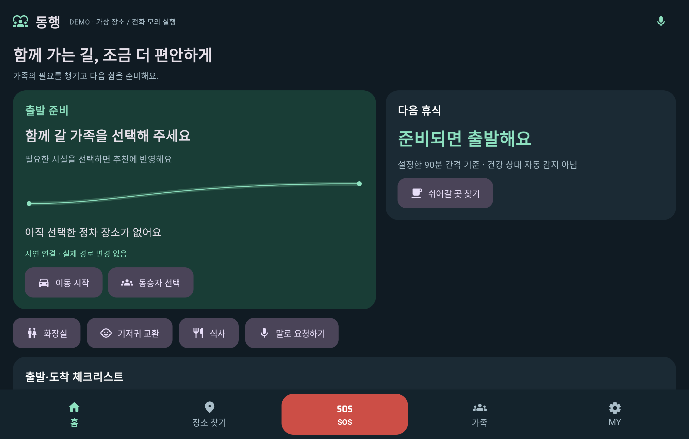
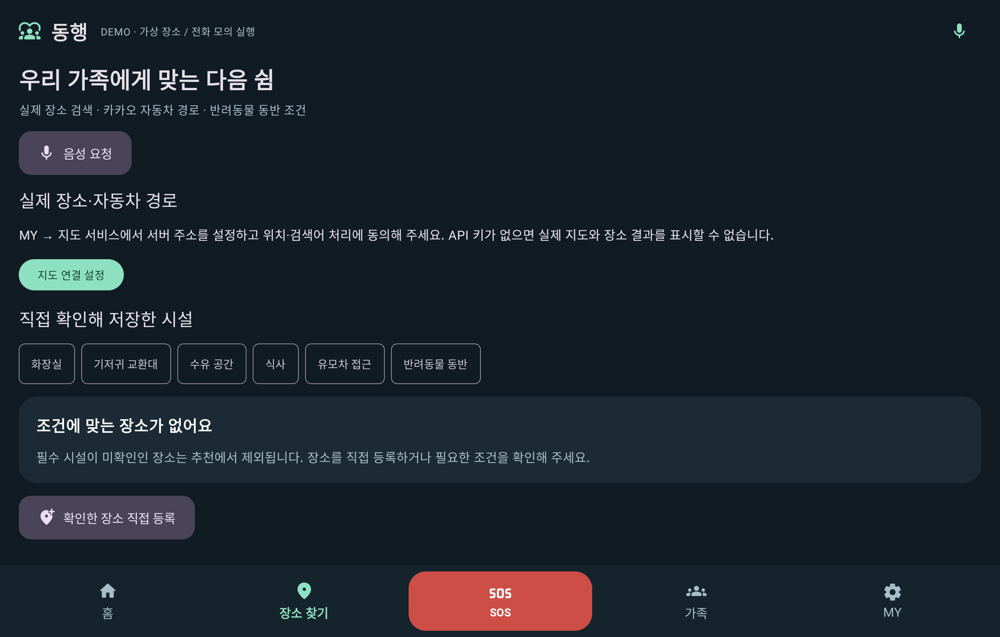
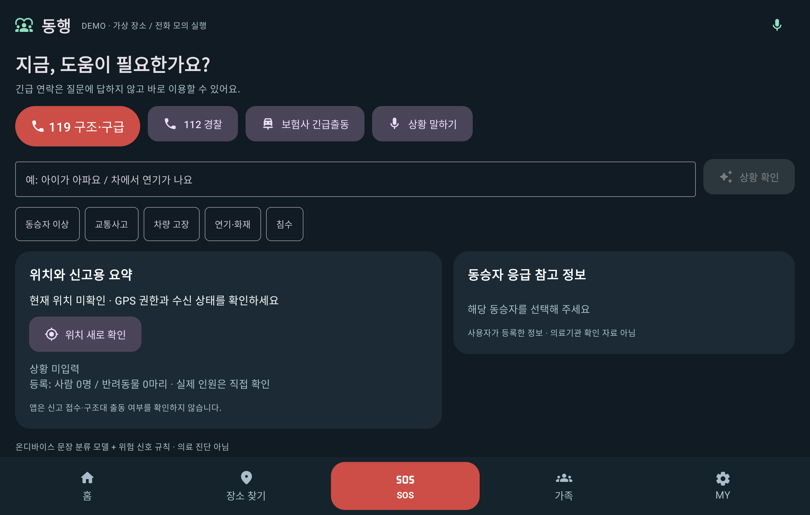
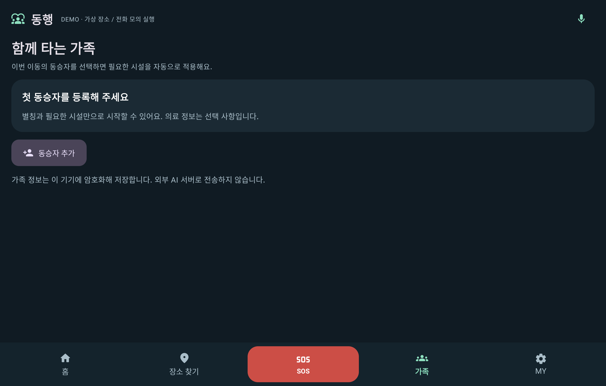
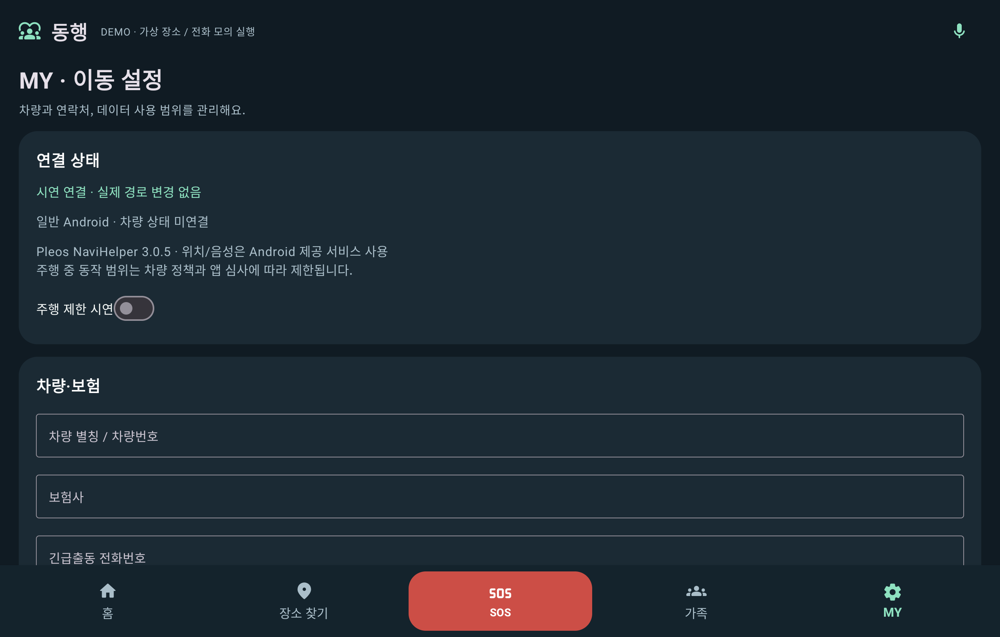

# 검증 기록 · 2026-10-24

## 실제 지도·반려동물 확장 검증

검증 소스: `dda1937bd4065d88af7dd73643d896c9dc636167` · [Actions 실행](https://github.com/tjdus3725/contest_project/actions/runs/40086578508)

- 핵심 로직 테스트 15개, 서버 HTTP·좌표·경로 주변 필터 테스트 10개 통과.
- demoDebug / pleosDebug APK 빌드 및 두 변형 Lint 통과.
- 일반 API 34 에뮬레이터에서 화면 전환·SOS 모의 실행 테스트 2개 통과.
- 아래 화면은 최신 앱의 기본 상태입니다. 지도 동의·키·서버 연결 전 안내 화면을 포함합니다.
- **본인 카카오 키가 없어 실제 지도 타일·실제 장소 응답·길찾기 실서비스 호출은 검증하지 못했습니다.** 서버 테스트는 외부 응답 fixture를 사용한 계약·오류 처리 검증입니다. 설정 후 [연결 절차](KAKAO_SETUP.md)의 실제 API 시험을 진행해야 합니다.

## 최초 버전 검증 기록

검증한 앱 소스 커밋: `39306d58dd0fd23c1342f9ce39f7f7da9666373f`.

[GitHub Actions 실행 결과](https://github.com/tjdus3725/contest_project/actions/runs/40074678093)

| 항목 | 결과 |
|---|---|
| `:core:test` | 13개 통과 |
| `:app:assembleDemoDebug` | APK 생성 성공 |
| `:app:assemblePleosDebug` | 실제 NaviHelper SDK를 사용한 APK 생성 성공 |
| `:app:lintDemoDebug` | 오류 0개 / 경고 7개 |
| `:app:lintPleosDebug` | 오류 0개 / 경고 7개 |
| `:app:connectedDemoDebugAndroidTest` | API 34 x86_64 에뮬레이터에서 2개 통과 |
| 화면 확인 | 홈·장소 찾기·SOS·가족·MY 캡처 확인 |

UI 테스트 범위는 5개 탭 전환과 SOS 모의 전화 버튼입니다. 모든 입력 흐름·권한 거절·암호화 복구·실차 동작을 자동 검증한 것은 아닙니다. 핵심 로직 테스트에는 필수 시설의 미확인 정보 제외, 동승자 조건, 위험 신호 우선 처리, 분류 보류, 휴식 계산, 전화번호 입력 검증이 포함됩니다.

남은 Lint 경고는 API 34 대상으로 인한 최신 API 안내와 고정된 라이브러리 버전의 업데이트 안내입니다. 검증 중 버전을 임의로 올리지 않았습니다.

## 실행 파일

Actions 결과물 `donghaeng-apks-and-reports`에 다음 파일과 보고서가 있습니다.

- `app-demo-debug.apk`: 일반 Android 시연용. 가상 장소, 전화 모의 실행.
- `app-pleos-debug.apk`: Pleos Connect용. 실제 NaviHelper 호출, 전화 화면 요청.

개발용 debug 서명입니다. 마켓 배포용 서명과 등록은 별도입니다.

## 화면

에뮬레이터에서 실제 앱을 실행해 캡처했습니다. 기본 상태이며 가족·연락처 등 개인정보는 들어 있지 않습니다.

### 홈

### 장소 찾기

### SOS

### 가족

### MY

## 아직 필요한 검증

- Pleos Connect 전용 에뮬레이터 및 실제 차량에서 경유지 반영·연결 해제·권한·주행 제한 확인.
- 음성 서비스 제공자별 한국어 인식·합성 및 위치 수신 확인.
- 실제 시설 데이터 조사와 운영시간·접근 방향 확인.
- 긴급 안내의 전문가 검수와 상황 분류 모델의 별도 평가.

일반 Android 에뮬레이터 테스트를 Pleos 실차 검증으로 해석하지 않습니다.
